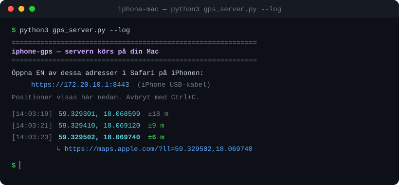

<div align="center">

# 📍 Activate GPS — read your phone's location on your computer

**Read the GPS location from your own phone directly on your computer.**
For iPhone (via Mac) and Android (via USB). Everything runs locally — no data leaves your machine.

[](#which-tool-should-i-use)
[](https://www.python.org/)
[-success)](#requirements)
[](LICENSE)
[](#-security--privacy)

[🇸🇪 Svenska](README.md) · **🇬🇧 English**



</div>

---

## Contents

- [Overview](#overview)
- [Which tool should I use?](#which-tool-should-i-use)
- [Requirements](#requirements)
- [Quick start](#quick-start)
- [How it works](#how-it-works)
- [Security & privacy](#-security--privacy)
- [Disclaimer](#️-disclaimer)
- [License](#license)

## Overview

This project contains two standalone tools for pulling **your own phone's GPS location** onto
your computer, depending on which phone you have. Both are written in Python and use only the
standard library — nothing to install via `pip`.

| | iPhone + Mac | Android |
|---|---|---|
| **Folder** | [`iphone-mac/`](iphone-mac/) | [`android/`](android/) |
| **Method** | Local web server + Safari (Geolocation API) | USB cable + ADB (`dumpsys location`) |
| **Connection** | Cable (iPhone USB network) or Wi-Fi | USB cable |
| **Requires on the phone** | You grant location access in Safari | USB debugging + your approval |
| **Live updates** | ✅ | ✅ (`--watch`) |
| **Log to file** | ✅ (`--log`) | ✅ (`--json`) |

> [!NOTE]
> Unlike Android, Apple does **not** allow a computer to read the iPhone's GPS directly over
> the cable. The iPhone tool therefore uses the browser's Geolocation API — the only path
> Apple permits. See [`iphone-mac/README.md`](iphone-mac/README.md) for details.

## Which tool should I use?

- 🍎 **Have an iPhone?** → [`iphone-mac/`](iphone-mac/README.md)
- 🤖 **Have an Android?** → [`android/`](android/README.md)

Each folder has its own detailed README with step-by-step instructions and troubleshooting.

> **Extra:** [`tid-per-plats/`](tid-per-plats/) — see how much time you spent at each place during
> the day (Google Maps Timeline, a private self-logger, or OwnTracks). [`ipad/`](ipad/) — show
> today's scheduled places on iPad/iPhone via a Shortcut or Scriptable.

## Requirements

- **Python 3.8 or later** (`python3 --version`)
- No external Python packages — standard library only
- **iPhone + Mac:** `openssl` (pre-installed on macOS)
- **Android:** `adb` (Android Platform Tools) on the computer, and USB debugging on the phone

## Quick start

**🍎 iPhone + Mac**

```bash
cd iphone-mac
python3 gps_server.py --log
```
Then open the printed address in Safari on the iPhone, tap **Start GPS** and allow location.

**🤖 Android**

```bash
cd android
python3 gps.py            # read once
python3 gps.py --watch    # continuous
```
Connect the phone via USB and tap **Allow** on the USB-debugging prompt.

Example output:

```
[14:03:21]  59.329301, 18.068599  ±8 m   https://maps.apple.com/?ll=59.329301,18.068599
```

## How it works

**iPhone + Mac** — the Mac starts a small HTTPS web server (a self-signed certificate is
created automatically). You open the page in Safari on the iPhone; the phone's real GPS is read
via the browser's `navigator.geolocation` and sent back to the Mac, which shows the location
live and can log it to a file.

**Android** — the computer asks the phone for its last known location via
`adb shell dumpsys location` and picks the best available source (`fused` → `gps` → `network`).
No root required.

## 🔒 Security & privacy

- **Everything runs locally.** The location only travels between your phone and your computer —
  nothing is sent to any external server, cloud service or third party.
- **Requires physical consent.** The iPhone tool requires you to grant location access in
  Safari; the Android tool requires you to approve USB debugging on the phone. The tools cannot
  read a phone you do not unlock and approve yourself.
- **No keys or accounts.** The tools need no API keys and don't log in anywhere.

## ⚠️ Disclaimer

These tools are intended **only for your own phone**, or a device you have explicit permission
to use. Do not use them to track anyone without their consent. You are responsible for ensuring
your use complies with applicable laws and regulations.

## License

Distributed under the **Apache License 2.0**. See [`LICENSE`](LICENSE) for the full text.
