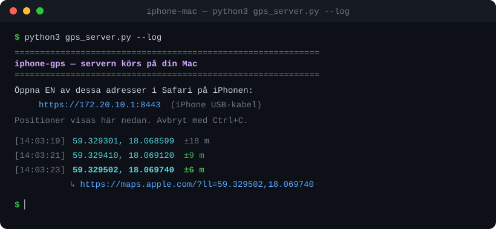

<div align="center">

# 📍 Aktivera GPS — läs din mobils position på datorn

**Läs GPS-positionen från din egen mobiltelefon direkt på din dator.**
För iPhone (via Mac) och Android (via USB). Allt körs lokalt — inga data lämnar din dator.

[](#vilket-verktyg-ska-jag-välja)
[](https://www.python.org/)
[-success)](#krav)
[](LICENSE)
[](#-säkerhet--integritet)

**🇸🇪 Svenska** · [🇬🇧 English](README.en.md)



</div>

---

## Innehåll

- [Översikt](#översikt)
- [Vilket verktyg ska jag välja?](#vilket-verktyg-ska-jag-välja)
- [Krav](#krav)
- [Snabbstart](#snabbstart)
- [Så fungerar det](#så-fungerar-det)
- [Säkerhet & integritet](#-säkerhet--integritet)
- [Ansvarsfriskrivning](#-ansvarsfriskrivning)
- [Licens](#licens)

## Översikt

Det här projektet innehåller två fristående verktyg för att hämta **din egen telefons
GPS-position** till din dator, beroende på vilken telefon du har. Båda är skrivna i Python
och använder bara standardbiblioteket — inget att installera via `pip`.

| | iPhone + Mac | Android |
|---|---|---|
| **Mapp** | [`iphone-mac/`](iphone-mac/) | [`android/`](android/) |
| **Metod** | Lokal webbserver + Safari (Geolocation-API) | USB-kabel + ADB (`dumpsys location`) |
| **Anslutning** | Kabel (iPhone-USB-nätverk) eller wifi | USB-kabel |
| **Kräver på telefonen** | Du godkänner platsåtkomst i Safari | USB-felsökning + din tillåtelse |
| **Live-uppdatering** | ✅ | ✅ (`--watch`) |
| **Loggning till fil** | ✅ (`--log`) | ✅ (`--json`) |

> [!NOTE]
> Till skillnad från Android tillåter **inte** Apple att en dator läser iPhonens GPS rakt
> över kabeln. iPhone-verktyget använder därför webbläsarens Geolocation-API — den enda
> väg Apple tillåter. Se [`iphone-mac/README.md`](iphone-mac/README.md) för detaljer.

## Vilket verktyg ska jag välja?

- 🍎 **Har du iPhone?** → [`iphone-mac/`](iphone-mac/README.md)
- 🤖 **Har du Android?** → [`android/`](android/README.md)

Varje mapp har en egen, utförlig README med steg-för-steg-instruktioner och felsökning.

## Krav

- **Python 3.8 eller senare** (`python3 --version`)
- Inga externa Python-paket — endast standardbiblioteket
- **iPhone + Mac:** `openssl` (finns förinstallerat på macOS)
- **Android:** `adb` (Android Platform Tools) på datorn, och USB-felsökning på telefonen

## Snabbstart

**🍎 iPhone + Mac**

```bash
cd iphone-mac
python3 gps_server.py --log
```
Öppna sedan den utskrivna adressen i Safari på iPhonen, tryck **Starta GPS** och tillåt plats.

**🤖 Android**

```bash
cd android
python3 gps.py            # läs en gång
python3 gps.py --watch    # löpande
```
Anslut telefonen med USB och tryck **Tillåt** på rutan om USB-felsökning.

Exempel på utskrift:

```
[14:03:21]  59.329301, 18.068599  ±8 m   https://maps.apple.com/?ll=59.329301,18.068599
```

## Så fungerar det

**iPhone + Mac** — Macen startar en liten HTTPS-webbserver (självsignerat certifikat skapas
automatiskt). Du öppnar sidan i Safari på iPhonen; telefonens riktiga GPS läses via
webbläsarens `navigator.geolocation` och skickas tillbaka till Macen, som visar positionen
live och kan logga den till fil.

**Android** — Datorn frågar telefonen efter senast kända position via
`adb shell dumpsys location` och väljer den bästa källan som finns (`fused` → `gps` →
`network`). Ingen root krävs.

## 🔒 Säkerhet & integritet

- **Allt körs lokalt.** Positionen går bara mellan din telefon och din dator — inget skickas
  till någon extern server, molntjänst eller tredje part.
- **Kräver fysiskt samtycke.** iPhone-verktyget kräver att du godkänner platsåtkomst i Safari;
  Android-verktyget kräver att du godkänner USB-felsökning på telefonen. Verktygen kan inte
  läsa en telefon du inte själv låser upp och godkänner.
- **Inga nycklar eller konton.** Verktygen behöver inga API-nycklar och loggar inte in någonstans.

## ⚠️ Ansvarsfriskrivning

Dessa verktyg är avsedda **endast för din egen telefon**, eller en enhet du har uttrycklig
tillåtelse att använda. Använd dem inte för att spåra någon annan utan samtycke. Du ansvarar
själv för att din användning följer tillämpliga lagar och regler.

## Licens

Distribueras under **Apache License 2.0**. Se [`LICENSE`](LICENSE) för fullständig text.
