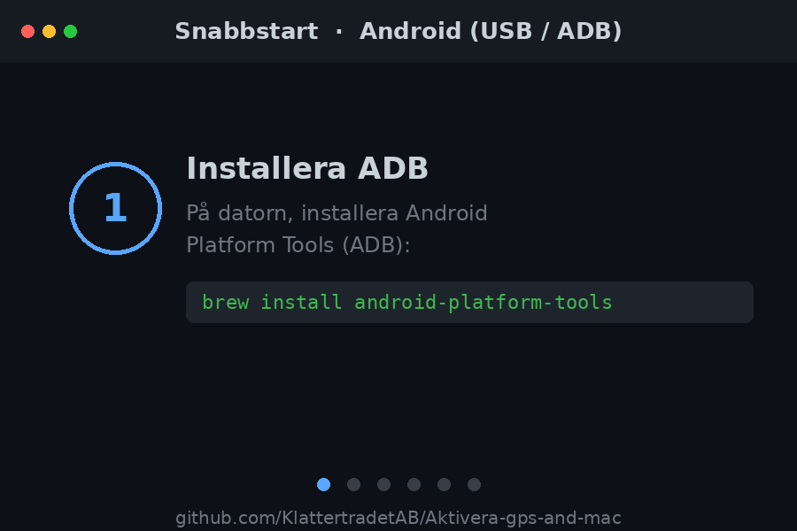

# 🤖 Android

**Läs GPS-positionen från din egen Android-telefon via USB-kabel, direkt på datorn.**

[](#)
[](https://www.python.org/)
[](https://developer.android.com/tools/releases/platform-tools)

Scriptet pratar med telefonen över **ADB** (Android Debug Bridge). Telefonen måste vara
ansluten med kabel och själv godkänna anslutningen — så det fungerar bara på en telefon du
fysiskt har och trycker "Tillåt" på. Inga positionsdata skickas någonstans; allt sker lokalt
mellan din dator och din telefon.

<div align="center">
  
</div>

## Funktioner

- 📍 Läs senast kända position en gång, eller löpande med `--watch`
- 🧭 Väljer automatiskt bästa källan (`fused` → `gps` → `network`)
- 🗺️ Färdig Google Maps-länk, plus höjd och osäkerhet
- 🧩 JSON-utdata (`--json`) för vidare bearbetning
- 🔌 Ingen root krävs — bara USB-felsökning

## Vad du behöver

- En dator (Windows, macOS eller Linux) med **Python 3.8+**
- **ADB / Android Platform Tools** installerat på datorn
- En Android-telefon med **USB-felsökning** påslaget
- En USB-kabel som kan överföra data (inte bara ladda)

## 1. Installera ADB på datorn

| System | Kommando / källa |
|---|---|
| Windows / macOS / Linux | [Platform Tools](https://developer.android.com/tools/releases/platform-tools) — lägg mappen i din PATH |
| macOS (Homebrew) | `brew install android-platform-tools` |
| Debian / Ubuntu | `sudo apt install android-tools-adb` |
| Arch | `sudo pacman -S android-tools` |

Kontrollera: `adb version`

## 2. Slå på USB-felsökning på telefonen

1. **Inställningar → Om telefonen** → tryck 7 gånger på **Versionsnummer** (aktiverar Utvecklarläge).
2. **Inställningar → System → Utvecklaralternativ** → slå på **USB-felsökning**.
3. Slå på **Plats / GPS** i snabbinställningarna (eller **Inställningar → Plats**).

## 3. Anslut och kör

1. Anslut telefonen med USB-kabel.
2. Lås upp telefonen. En ruta visas: **"Tillåt USB-felsökning?"** — tryck **Tillåt**
   (bocka gärna i "Tillåt alltid från den här datorn").
3. Kör scriptet:

```bash
python3 gps.py        # läs positionen en gång
./gps.sh              # eller via wrappern
```

## Användning

```bash
python3 gps.py                # läs positionen en gång
python3 gps.py --watch        # läs om positionen var 5:e sekund
python3 gps.py --watch -i 2   # var 2:a sekund
python3 gps.py --json         # skriv ut som JSON (bra för vidare bearbetning)
python3 gps.py --check        # kontrollera bara anslutning och att GPS är på
```

Exempel på utskrift:

```
Position:   59.329300, 18.068600
Källa:      fused
Osäkerhet:  ±12 m
Karta:      https://www.google.com/maps?q=59.329300,18.068600
```

## Hur det fungerar

Telefonen samlar själv in positionen via sin GPS-mottagare. Scriptet frågar Android efter
**senast kända position** med `adb shell dumpsys location` och plockar ut koordinaterna. Den
väljer den bästa källan som finns (`fused` före `gps` före `network`).

## Felsökning

| Problem | Lösning |
|---|---|
| `adb: command not found` | ADB är inte installerat / inte i PATH (se steg 1). |
| "Telefonen är ansluten men inte godkänd" | Lås upp telefonen och tryck **Tillåt** på USB-felsökningsrutan. |
| "Ingen telefon hittades" | Kontrollera kabeln (måste klara data), prova annan USB-port, slå på USB-felsökning. |
| "Ingen position tillgänglig ännu" | Öppna en kart-app (t.ex. Google Maps) en stund så GPS får fix, försök sen igen. Gå gärna nära ett fönster/ut. |
| Flera enheter anslutna | Koppla ur övriga, eller sätt `export ANDROID_SERIAL=<serienummer>`. |

## Noter

- Ingen root behövs på telefonen.
- Fungerar bäst med `fused`-källan, som kombinerar GPS, wifi och mobilnät.
- Precisionen beror på telefonens GPS-fix just då — inomhus blir den sämre.

## Och iPhone?

Mappen [`../iphone-mac/`](../iphone-mac/) innehåller motsvarande verktyg för iPhone + Mac.

---

> **Endast för din egen enhet.** Använd verktyget bara på en telefon du själv äger eller har
> uttrycklig tillåtelse att använda.
